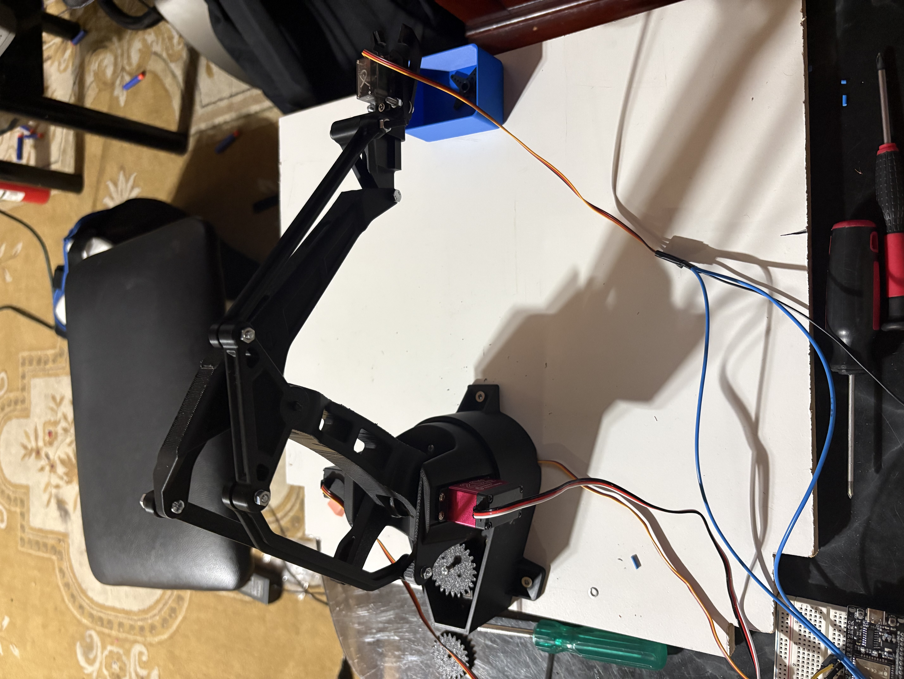

# natHacks-26

A voice- and text-controlled EEZYbot Arm Mk2. You say "grab this item, put it in the blue container, then come back
to me". The arm parses the command, finds the container with a camera, plans a safe path and drives the servos on an
ESP32 over an authenticated serial link.

Built at natHacks 2026. The aim is an assistive arm that someone can hand an object to and tell, in plain speech,
where to put it.



## How to access it

- **Source code:** <https://github.com/asehmb/natHacks-26>
- **Clone:** `git clone https://github.com/asehmb/natHacks-26.git && cd natHacks-26`
- **Requirements:** Python 3.10+, a webcam, and (to drive real hardware) an EEZYbot Arm Mk2 wired to an ESP32. Without
  the arm or a camera, the language side, the planner and the simulator all still run (see
  [Quick start](#quick-start-end-to-end) step 4 and [Running the parts on their own](#running-the-parts-on-their-own)).

```
 speech / text ──► nlp/ (parser → typed actions)
                        │
                        ▼
 camera ──────────► vision/ (container finder → base-frame mm)
                        │
                        ▼
                   Kinematics/ (IK, straight-line planner, limits)
                        │
                        ▼
                   firmware/comms/ (ArmLink: COBS + HMAC-SHA256 packets) ──► ESP32 ──► servos
```

## Repository layout

| Folder                                | What it does                                                                                                                                                                                                                   | Details                                                                                            |
| ------------------------------------- | ------------------------------------------------------------------------------------------------------------------------------------------------------------------------------------------------------------------------------ | -------------------------------------------------------------------------------------------------- |
| [`nlp/`](nlp/README.md)               | Turns sentences into typed actions (`PickUp`, `PutIn`, `ReturnToUser`, …). Stdlib-only rule parser with typo correction, optional local LLM fallback (Ollama), and open-vocabulary object grounding (YOLO-World + CLIP, ONNX). | [nlp/README.md](nlp/README.md)                                                                     |
| [`vision/`](vision/README.md)         | `armvision`: the marker-free container finder (`find_containers.py`), the older ArUco mat pipeline, and the end-to-end `talk_to_arm.py`.                                                                                       | [vision/README.md](vision/README.md)                                                               |
| [`Kinematics/`](Kinematics/README.md) | EEZYbot Mk2 FK/IK in meters and radians, pick-and-place primitives, a planner state machine, a `MockArm`, a 3D simulator and the shared `arm_config.yaml`.                                                                     | [Kinematics/README.md](Kinematics/README.md)                                                       |
| `firmware/comms/`                     | ArmLink protocol: C library (`armlink.c/h`), the ESP32 sketch `combined_only/`, and the Python host sender `send_ik.py`. Hardware test records are in the `*_TEST.md` files.                                                   | [COMBINED_TEST.md](firmware/comms/COMBINED_TEST.md), [ACK_SENDER.md](firmware/comms/ACK_SENDER.md) |
| `firmware/servoWork/`                 | Original plain-text servo sketch (`base 90`, …), kept for bench testing. It does not speak ArmLink.                                                                                                                            |                                                                                                    |

## Hardware

- EEZYbot Arm Mk2 with four servos: base, shoulder, elbow, gripper (ESP32 pins 18, 19, 21, 22).
- ESP32 running `firmware/comms/combined_only/combined_only.ino`.
- Any webcam or an iPhone through Continuity Camera, looking down at a white sheet that the containers sit on.

**The base servo is currently broken and disabled in firmware** (`servo_bridge.h`, `enabled[0] = false`). The arm
only moves forward/back and up/down along its centre line, so containers must sit on that line (y = 0, within
`--y-tol-mm`).

## Quick start (end to end)

Python 3.10+ is required. From the repo root:

```bash
cd vision
python -m venv .venv
.venv/bin/pip install -e '.[dev,arm]'      # add ',voice' for push-to-talk; nlp/ is put on the path automatically
```

1. **Calibrate the camera to the sheet** (once, and again whenever the camera moves). No printed markers are needed:

   ```bash
   .venv/bin/python find_containers.py --calibrate --source 0
   ```

   Click the two far corners and the two pen ticks, check the reported error, then press `s`. See
   [vision/README.md](vision/README.md#container-finder-no-markers) for the full procedure.
2. **Dry run.** Every MOVE is validated and printed, and nothing is sent:

   ```bash
   .venv/bin/python talk_to_arm.py --source 0
   ```

3. **Real arm.** It asks before the first move:

   ```bash
   .venv/bin/python talk_to_arm.py --source 0 --port /dev/cu.usbserial-10 [--mic]
   ```

4. **No camera or arm** (handy for testing the language side):

   ```bash
   .venv/bin/python talk_to_arm.py --no-gui --container blue:250:36.5 \
       --say "grab this item, put it in the blue container, then come back to me"
   ```

Supported commands are "grab this item", "put it in the <colour> container", "open your hand" and "come back to me".
Quitting sends STOP, which detaches the servos, so hold the arm up when you quit.

## Running the parts on their own

```bash
# Container vision only
cd vision && .venv/bin/python find_containers.py --source 0 --target red [--json] [--debug]

# Kinematics simulator (MockArm, 3D plot)
cd Kinematics && pip install -r requirements.txt && python simulate.py --goto 0.22 0.0 0.15

# Firmware sender, packet only (no hardware)
python3 firmware/comms/send_ik.py --dry-run --xyz 0.20 0.0 0.15

# NLP demo
cd nlp && python demo.py
```

## Tests

Each component has its own suite. Run each one from its folder:

```bash
cd nlp        && python -m pytest -q     # core needs only pytest + numpy; vision tests skip without opencv/onnxruntime
cd vision     && python -m pytest -q
cd Kinematics && python -m pytest -q
```

CI (`.github/workflows/tests.yml`) runs the `nlp` suite on Python 3.10, 3.12 and 3.14, the `nlp` vision extras, and the
`vision` suite on synthetic scenes. The Kinematics and firmware tests are not in CI yet.

## Safety

- Every path is IK-solved and checked against the joint limits **before** the first MOVE is sent. If one waypoint is
  unreachable, the arm does not move at all.
- The firmware enforces its own limits. It only accepts authenticated, in-order packets while armed, and it disarms
  when heartbeats stop.
- The HMAC key in `send_ik.py` and the firmware is a **development test key** (`0x0B` × 32). Change it before running
  outside a bench setup.
- The LLM fallback only produces actions that pass schema validation. It never talks to the servos directly.

## Known limits

- The base cannot rotate (see [Hardware](#hardware)).
- At a 60 mm hover height, IK reaches only about 235–265 mm from the base (312 mm at most).
- The gripper open and closed angles are placeholders. Tune `--gripper-open` and `--gripper-closed` first.
- Only coloured containers are detected, so white, black and clear ones are missed. Touching containers of the same
  colour merge into one.
- The YOLO-World weights used by `nlp/vision` are AGPL-3.0.

## Supporting materials

There are no slides or demo video yet. Everything below is in this repository.

| Material                                                                                                                                                   | What it shows                                                                                          |
| ---------------------------------------------------------------------------------------------------------------------------------------------------------- | ------------------------------------------------------------------------------------------------------ |
| [Live container detection](vision/containers.png)                                                                                                          | The camera view with the detected container outlined (base and rim) and its position in the arm frame. |
| [Debug view](<vision/debug output.png>)                                                                                                                    | The top-down debug window: green blobs became containers, red ones were dropped (with the reason).     |
| [Sheet layout](vision/sheet_layout.png)                                                                                                                    | Where the arm, camera, pen ticks and calibration clicks go on the white sheet.                         |
| [nlp/README.md](nlp/README.md)                                                                                                                             | Parser actions, LLM fallback and open-vocabulary grounding.                                            |
| [vision/README.md](vision/README.md)                                                                                                                       | Container finder calibration, JSON output, arm moves and `talk_to_arm.py` options.                     |
| [Kinematics/README.md](Kinematics/README.md), [MEASUREMENTS.md](Kinematics/docs/MEASUREMENTS.md)                                                           | Kinematics conventions, shared config and the arm measurement worksheet.                               |
| [firmware/comms/COMBINED_TEST.md](firmware/comms/COMBINED_TEST.md) and the other `*_TEST.md` files                                                         | Recorded ESP32 results for the handshake, heartbeat, rejection and reliability tests.                  |
| [.claude/plan.md](.claude/plan.md), [container-finder-plan.md](.claude/container-finder-plan.md), [container-move-plan.md](.claude/container-move-plan.md) | Design notes for the NLP, the marker-free container finder and the container moves.                    |
| [CI workflow](.github/workflows/tests.yml)                                                                                                                 | The automated tests that run on every push and pull request.                                           |
